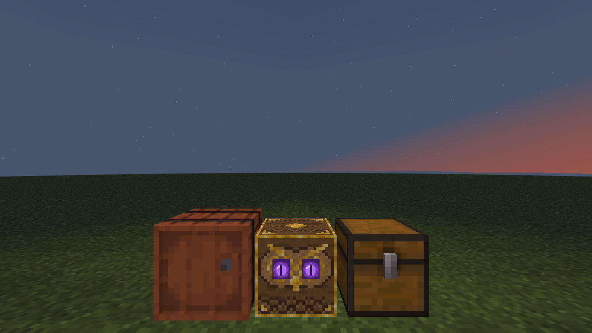
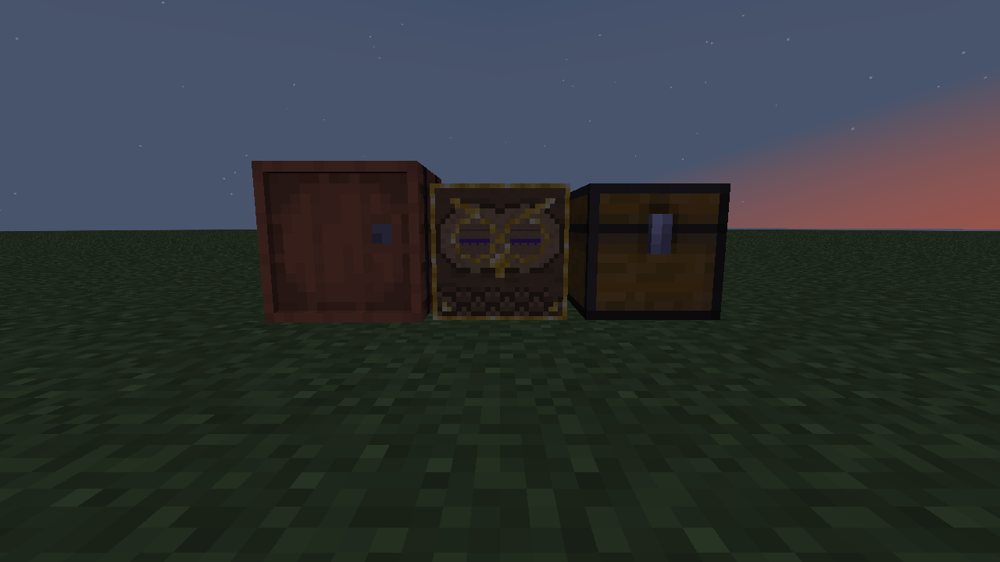

# Hot Deposit

An add-on for [Sophisticated Item Actions](https://github.com/P3pp3rF1y/SophisticatedItemActions) (NeoForge 1.21.1).

Adds the **Hot Deposit** block. Right-clicking it does what Sophisticated Item Actions' **Shift + '** does: every item in your main inventory (not the hotbar) that already matches something in nearby storage gets deposited into that storage. It's meant for controller players who can't easily bind a modifier + key combo.

The block is a carved wooden owl with gold trim. Its two purple eyes open and glow when a player in range is carrying something that can be deposited, and close when there's nothing to deposit. Inventory changes show within about a second; changes to what's inside the storages show within about 5 seconds.

| Something to deposit: eyes open | After depositing: eyes closed |
|---|---|
|  |  |

The eye checks are built to stay cheap on busy servers: blocks with no player in range do no work, the list of nearby storages is cached and rescanned every 5 seconds, each player's answer is reused until their inventory changes, and all Hot Deposit blocks share one queue that runs at most 4 real checks per tick.

- **Requires** Sophisticated Item Actions 0.5.19 or newer (and Sophisticated Core, which SIA already needs).
- Tested with Sophisticated Item Actions 0.5.19, Sophisticated Core 1.5.31, Sophisticated Storage 1.6.16 and Sophisticated Backpacks 3.26.20 (NeoForge 21.1).
- Works with an item in hand too. Sneak-right-click places blocks against it as usual.
- Breaks as fast as a chest (hand or any tool; axes are faster) and drops itself.
- Light level 10 (like a soul lantern) while the eyes are open, none while closed.

## Config

Open it from the Mods list (select Hot Deposit, then Config), or edit `config/hotdeposit-common.toml`.

- **Deposit Range** (default 10, max 32): how far from the block storages are searched. Unlike the keybind, this is measured from the block, not the player.
- **Storage Blacklist**: storages that are never deposited into. Entries can be a block or entity id (`minecraft:furnace`, `minecraft:armor_stand`), a whole mod (`somemod:*`) or a tag (`#c:chests`). Defaults: armor stand, furnace, blast furnace, smoker, brewing stand.

## Recipe

```
G G G      G = Gold Ingot
E C E      E = Eye of Ender
G F G      C = Chest
           F = Feather
```

## Building

```
./gradlew build
```

The jar ends up in `build/libs/` as `hotdeposit-mc<minecraft version>-<mod version>.jar`.

## License

MIT, see [LICENSE](LICENSE).
