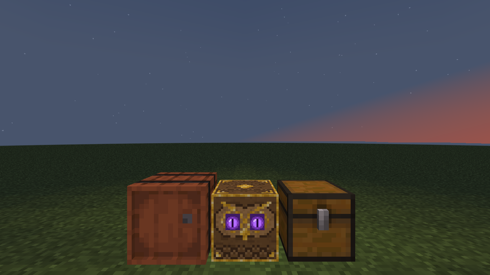
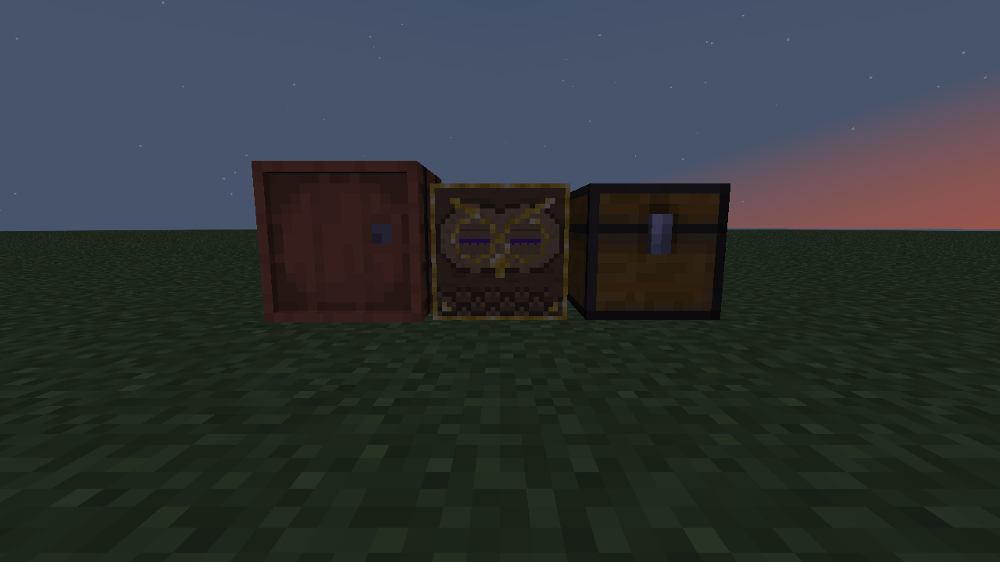

# Hot Deposit

An add-on for [Sophisticated Item Actions](https://github.com/P3pp3rF1y/SophisticatedItemActions), for Minecraft 1.20.1 through 26.3 (see [Versions](#versions)).

Adds the **Hot Deposit** block. Right-clicking it does what Sophisticated Item Actions' **Shift + '** does: every item in your main inventory (not the hotbar) that already matches something in nearby storage gets deposited into that storage. It's meant for controller players who can't easily bind a modifier + key combo.

The block is a carved wooden owl with gold trim. Its two purple eyes open and glow when a player in range is carrying something that can be deposited, and close when there's nothing to deposit. Inventory changes show within about a second; changes to what's inside the storages show within about 5 seconds.

| Something to deposit: eyes open | After depositing: eyes closed |
|---|---|
|  |  |

The eye checks are built to stay cheap on busy servers: blocks with no player in range do no work, the list of nearby storages is cached and rescanned every 5 seconds, each player's answer is reused until their inventory changes, and all Hot Deposit blocks share one queue that runs at most 4 real checks per tick.

- **Requires** Sophisticated Item Actions (and Sophisticated Core, which SIA already needs); the minimum SIA version for each Minecraft version is in [Versions](#versions).
- Works with an item in hand too. Sneak-right-click places blocks against it as usual.
- Breaks as fast as a chest (hand or any tool; axes are faster) and drops itself.
- Light level 10 (like a soul lantern) while the eyes are open, none while closed.

## Versions

Each Minecraft version is built from its own branch, like Sophisticated Item Actions itself. Every version below was tested in game: the eyes open next to a matching chest and a right-click deposits into it.

| Minecraft | Loader | Branch | Needs Sophisticated Item Actions |
|---|---|---|---|
| 1.20.1 | Forge 47 or NeoForge 47.1 | [`1.20.1`](../../tree/1.20.1) | 0.4.21+ |
| 1.21.1 | NeoForge 21.1 | [`main`](../../tree/main) | 0.5.19+ |
| 1.21.4 | NeoForge 21.4 | [`1.21.4`](../../tree/1.21.4) | 0.4.11+ |
| 1.21.5 | NeoForge 21.5 | [`1.21.5`](../../tree/1.21.5) | 0.4.11+ |
| 1.21.8 | NeoForge 21.8 | [`1.21.8`](../../tree/1.21.8) | 0.4.11+ |
| 1.21.10 | NeoForge 21.10 | [`1.21.10`](../../tree/1.21.10) | 0.4.11+ |
| 1.21.11 | NeoForge 21.11 | [`1.21.11`](../../tree/1.21.11) | 0.4.14+ |
| 26.1.2 | NeoForge 26.1.2 | [`26.1`](../../tree/26.1) | 0.4.19+ |
| 26.2 | NeoForge 26.2 | [`26.2`](../../tree/26.2) | 0.4.18+ |
| 26.3 | NeoForge 26.3 | [`26.3`](../../tree/26.3) | 0.4.20+ |

Differences between versions:

- **1.20.1** has no in-game config screen (Forge has no built-in one); edit `config/hotdeposit-common.toml` instead.
- **26.3** stores the settings in `config/hotdeposit-local.toml`.

## Config

Open it from the Mods list (select Hot Deposit, then Config), or edit `config/hotdeposit-common.toml` (`hotdeposit-local.toml` on 26.3).

- **Deposit Range** (default 10, max 32): how far from the block storages are searched. Unlike the keybind, this is measured from the block, not the player.
- **Storage Blacklist**: storages that are never deposited into. Entries can be a block or entity id (`minecraft:furnace`, `minecraft:armor_stand`), a whole mod (`somemod:*`) or a tag (`#c:chests`). Defaults: armor stand, furnace, blast furnace, smoker, brewing stand.

## Recipe

```
G G G      G = Gold Ingot
E C E      E = Eye of Ender
G F G      C = Chest
           F = Feather
```

## Building

Check out the branch for the Minecraft version you want, then:

```
./gradlew build
```

The jar ends up in `build/libs/` as `hotdeposit-mc<minecraft version>-<mod version>.jar`. Gradle downloads the Java version each branch needs (17 for 1.20.1, 21 for 1.21.x, 25 for 26.x).

## License

MIT, see [LICENSE](LICENSE).
